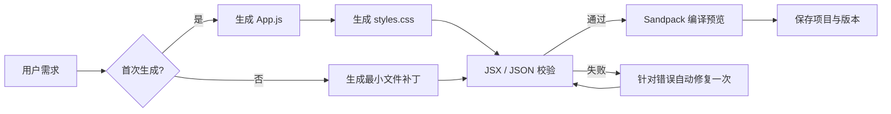

# Forge AI Studio

Forge 是一个无需注册的 AI 应用工作台：用户通过对话生成和修改 React 应用，代码在浏览器内实时编译并展示。

- 在线体验：https://forge-ai-studio-kara.netlify.app/
- 技术栈：React、TypeScript、Vite、Sandpack、DeepSeek API、Netlify Functions

## 功能

- 自然语言创建应用及连续迭代
- DeepSeek 驱动的文件操作协议：`write_file` / `replace_text`
- 首次建站按 `App.js` 与 `styles.css` 分步生成，减少长输出和截断
- Sandpack 隔离编译、实时预览与代码编辑
- JSX 语法检查，失败时自动进行一次针对性修复
- 编译错误提示与一键 AI 修复入口
- Code 编辑自动持久化，并可保存为独立版本
- 项目 Dashboard，以及多项目创建、切换、重命名与删除
- 项目聊天、代码和版本历史分别持久化
- 版本恢复与修改文件记录
- 真实文件操作进度与项目 ZIP 导出
- 响应式桌面/移动端界面

## 生成流程



模型只返回文件操作，不返回整个仓库。普通修改使用精确搜索替换；只有首次创建或大规模重构才写入完整文件。确认语如“开始吧”“继续”不会触发重复生成。

## 本地运行

```bash
npm install
npm run dev
```

前端开发服务器不能独立执行 Netlify Function。需要测试真实 AI 时，请安装 Netlify CLI 并运行：

```bash
netlify dev
```

在 Netlify 环境变量中配置：

```text
DEEPSEEK_API_KEY=your_key
```

API Key 仅在服务端函数中读取，不会进入浏览器代码。

## 部署

仓库已包含 `netlify.toml`：

- 构建命令：`npm run build`
- 发布目录：`dist`
- 函数目录：`netlify/functions`
- `/api/generate` 转发至生成函数
- SPA 路由回退至 `index.html`

在 Netlify 导入仓库并添加生产环境变量 `DEEPSEEK_API_KEY` 即可部署。

## 数据与安全边界

项目数据保存在浏览器 `localStorage`，适合无需注册的笔试 Demo，不支持跨设备同步。DeepSeek Key 保存在 Netlify 服务端环境变量中。接口限制提示词与项目体积，并拒绝无效请求。

## 当前限制

- 运行时错误检测依赖 Sandpack 提供的错误状态；复杂业务逻辑仍需要人工验证
- 项目保存在单个浏览器，清除站点数据后无法恢复
- 暂无多人协作与公开分享链接
- 暂无服务端账号、数据库和全局用量控制

## 后续优先级

1. 云端项目与分享链接
2. 流式 Agent 事件与可取消任务
3. 更完整的运行时测试和自动修复闭环
4. 项目 ZIP 导出和发布流水线
